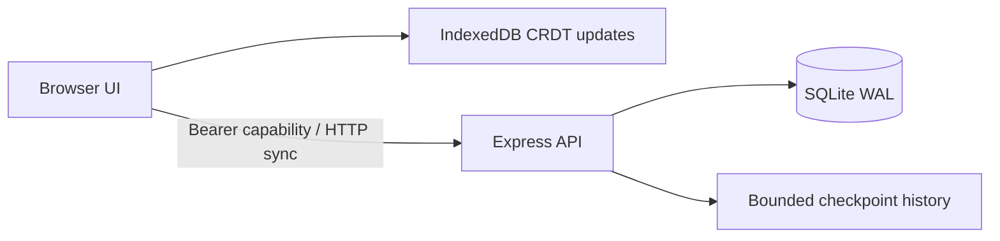

# CodeRoom

**Collaborative coding interviews.** A working local application built with AI assistance, with source code, repeatable tests and documented engineering tradeoffs.

## What it does

CodeMirror editor with JavaScript syntax support and per-client undo; Yjs merging; shared interview notes; bounded QuickJS execution; JSON test cases; saved checkpoint review.

## Run it

Requires Node.js 24.13.1 or newer and npm. Initial installation requires internet. No GPU, paid account or API key is required.

```sh
git clone https://github.com/Aaroh08/coderoom.git
cd coderoom
npm ci
npm run build
npm test
npm start
```

Open **http://127.0.0.1:5071**. On Windows you can also run `start.ps1` after `npm ci`. Keep the terminal open. Ctrl+C stops the application. Database files are created in ignored `data/`. Stop the server before copying the entire data directory for a local backup; protect both database backups and invite links.

Create an interview room, click Insert starter, run the two supplied Two Sum cases, edit interview notes, and load saved checkpoints. Open the invite in another browser profile to collaborate.

## Architecture



The web server sends code to a separate child process. QuickJS runs it in a WebAssembly interpreter with no host bindings or module loader. A one-second interrupt budget and three-second process deadline stop runaway execution; two simultaneous workers are allowed. QuickJS is configured with a 16 MB memory limit and 256 KB stack limit, but these are not a hard operating-system RSS quota. The process V8 heap limit also does not cap all native/WASM memory. Internet-facing execution requires a dedicated sandbox service with OS/container isolation and resource enforcement.

The shared document syncs every 1.5 seconds. Updates merge server-side with Yjs and persist in a transaction together with a checkpoint. Retrying an unchanged update is idempotent. The latest 100 checkpoints are retained per workspace; current document state is limited to 1 MB. This single-process design favors maintainability and demonstration over horizontal scaling.

## Verification

`npm run check` rebuilds the browser bundle and runs the Node test suite. Tests use real HTTP servers, SQLite, authentication middleware and CRDT updates. See [recorded test output](artifacts/verification.txt). GitHub Actions repeats the build and tests on Linux/Node 24. Tests cover access isolation, cross-origin rejection, malformed sync updates, idempotent retries, invite rotation, database restart recovery and ten independently edited clients.

See [verification notes](docs/VERIFICATION.md) for completed browser checks and their limits. A passing test suite is evidence for the cases exercised, not a promise of zero defects.

## Access and privacy

Workspaces use random 256-bit bearer capabilities. Only a SHA256 token hash is stored server-side. The browser keeps the invite in local storage and the URL fragment. Anyone with the invite has full workspace access, including key rotation. Replace the invite key to revoke old server access; this cannot erase copies already downloaded by collaborators. There are no user accounts, role-based permissions or account recovery.

No analytics or remote AI calls are implemented. Code, notes and document contents are stored locally in SQLite and browser storage as applicable. Do not treat this as an encrypted vault. Use fictional content for public demos. All SQL values use bound parameters, and rendered source passages are escaped.

## Scope and production readiness

Execution supports synchronous JavaScript functions named solve. There is no Python/C++ execution, video calling, remote cursor presence, grading security, hidden tests or assessment anti-cheating. Checkpoints are snapshots, not a video replay. Candidate code and test harness share the interpreter, so results are for collaborative practice, not trusted examination scoring.

This is a tested portfolio application, **not a certified production service**. Before an internet deployment, add named-user authentication and authorization, TLS, deployment-specific origin/host controls, stronger per-user quotas, backup/restore drills, security review, monitoring, privacy/retention controls and realistic load testing. Node's built-in SQLite API is experimental in the tested runtime. No availability SLA, penetration-test certification or production-scale performance claim is made.

## Repository guide

- `src/server.mjs`: project API and entry point.
- `src/core.mjs`: persistent workspaces, access control and sync protocol.
- `src/client.js`: project-specific UI.
- `src/shared.js`: local persistence and synchronization.
- `tests/`: reproducible integration and regression tests.
- [Architecture and operations](docs/ENGINEERING.md)
- [Demo and interview guide](docs/DEMO.md)
- [Security model](SECURITY.md)

## References

- [Yjs shared data and persistence](https://docs.yjs.dev/)
- [Node SQLite API](https://nodejs.org/download/release/latest-v24.x/docs/api/sqlite.html)
- [QuickJS WebAssembly bindings](https://github.com/justjake/quickjs-emscripten) (CodeRoom)
- [Mozilla PDF.js](https://github.com/mozilla/pdf.js) (EvidenceDesk)
